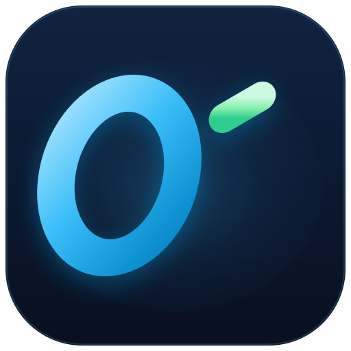
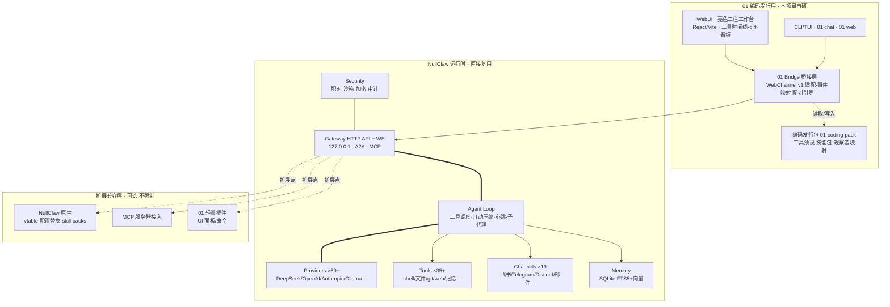

# 01 编码 · 项目设计方案

> **从 0 到 1,一气呵成** —— 开箱即用 · 兼容扩展的 AI 编码发行版
>
> 版本:v2.0 · 日期:2026-11-07 · 状态:设计评审稿
>
> **合成公式:NullClaw 后端运行时 × DeepSeek Harness 风格前端 × 编码场景纵深**

---

## 1. 项目概述

### 1.1 一句话定位

**01 编码(01Code)** 是一个 **AI 编码发行版(Agent Distro)**:**后端直接基于 [NullClaw](https://github.com/nullclaw/nullclaw) 运行时**(网关、Agent 循环、50+ 模型供应商、35+ 工具、19 渠道、记忆与安全体系全复用),**前端按 [DeepSeek Harness](https://github.com/deepseek-ai/deepseek-harness) 的 WebUI 风格合成**一套亮色三栏对话式工作台,再叠加编码场景纵深(仓库地图、diff 渲染、PR 级任务流)。

核心原则:**核心内置、开箱即用;不做"万物皆插件",但对插件保持兼容**。

### 1.2 命名释义

| 元素 | 含义 |
|---|---|
| `0` | Agent 循环(Ring):感知 → 推理 → 行动 → 观察,闭环不息 |
| `1` | 执行(Caret):一次确定的、可验证的落地动作;同时是终端里的光标 |
| `01` | 二进制的本源,软件世界的最小单元;也是「从 0 到 1」的创造隐喻 |
| `编码` | 聚焦编码场景,与 NullClaw(通用助理)、DeepSeek Harness(通用 Harness)形成差异化 |

### 1.3 设计口号

- 主口号:**从 0 到 1,一气呵成**
- 副口号:开箱即用 · 兼容扩展

---

## 2. 竞品研究与合成决策

### 2.1 两个参考对象

| 维度 | [NullClaw](https://github.com/nullclaw/nullclaw)(Zig) | [DeepSeek Harness `dsh`](https://github.com/deepseek-ai/deepseek-harness)(TS) |
|---|---|---|
| 定位 | 超轻量自主助理基础设施(678KB 单二进制、~1MB 内存) | 插件优先的 Agent Harness("Everything is a Plugin",Cordis 架构) |
| 形态 | CLI-first + Gateway HTTP API,无自带图形 UI(委托 nullhub / WebChannel v1) | CLI + 浏览器 WebUI(默认 `127.0.0.1:3080`) |
| 供应商 | 50+ Provider,`custom:` 任意 OpenAI 兼容端点 | 绑定 DeepSeek 系,插件扩展 |
| 渠道 | 19 渠道(Telegram/Discord/飞书/钉钉/QQ/邮件…) | 编辑器/SSH/浏览器 |
| 工具 | 35+(含硬件外设:串口/GPIO) | 工具/技能/Profile 均为插件 |
| 记忆 | SQLite FTS5 + 向量混合检索,后端可换 | 插件化 |
| 安全 | 配对授权、Landlock/Firejail/Docker 沙箱、ChaCha20 加密、审计日志 | SAFETY.md + 约束校验 |
| 扩展 | vtable 接口全可替换(配置驱动)、skill packs、MCP、A2A、子代理 | 一切皆插件(npm 分发) |

### 2.2 合成决策(**后端基于 NullClaw,前端基于 dsh 风格,不做成全插件**)

1. **后端 → 基于 NullClaw(真·基于,不重造)**
   直接捆绑 NullClaw 单二进制作为运行时:网关(127.0.0.1)、Agent Loop、多供应商、工具、渠道、SQLite 混合记忆、沙箱与配对授权**全部复用**。01 编码不写内核,零 Zig 构建负担——我们只做「发行版」:编码配置预设 + 技能包 + 前端。上游升级即随版受益。
2. **前端 → 基于 DeepSeek Harness WebUI 风格合成**
   采纳其「本地起服 + 浏览器打开」的对话式三栏形态与交互心智,在此基础上做 **01 品牌化重设计**:亮色主题、天蓝×浅绿视觉体系、工具时间线、上下文仪表、任务看板。
3. **扩展性 → 内置为主,兼容插件即可**
   **不做** "Everything is a Plugin":Provider/工具/渠道/命令核心全部内置开箱;同时提供三层兼容扩展(见 §5.2):NullClaw 原生配置替换与 skill pack、MCP 服务器接入、可选的 01 轻量插件。
4. **差异化聚焦:编码场景**
   预装编码工具链与工作流(仓库地图、单测约定、PR 流),不做泛助理。

---

## 3. 品牌视觉设计

### 3.1 Logo(手绘 SVG)

深色主用图标:



**主用 Logo 为「一行式组合」**——图标与「01 编码」字标同处一行(与 UI 标题栏一致),共两版:

| 文件 | 用途 |
|---|---|
| [logo/01-logo-horizontal.svg](logo/01-logo-horizontal.svg) | **一行式组合 · 主用**(深色底):官网头图、README、深色启动页 |
| [logo/01-logo-lockup-light.svg](logo/01-logo-lockup-light.svg) | **一行式组合 · 亮色底**:亮色 WebUI 标题栏、浅色文档 |
| [logo/01-mark-dark.svg](logo/01-mark-dark.svg) | 应用图标(深色,512×512,rx 112) |
| [logo/01-mark-light.svg](logo/01-mark-light.svg) | 应用图标(亮色环境) |
| [logo/01-glyphs.svg](logo/01-glyphs.svg) | 透明字形:水印、favicon、Loading 动画母版 |

**设计语言:**

| 元素 | 设计含义 |
|---|---|
| `0` = 天蓝渐变圆环 | Agent 循环 Ring;天蓝 = 天空/可能性/交互与执行色 |
| `1` = 浅绿笔画(竖干 + 旗形起笔) | 执行/落地产物;浅绿 = 生长/成功/产物色 |
| `01` 整体 8° 右倾斜切 | 速度感、代码斜体气质(如 IDE italic);`0` 与 `1` 同行并列 |
| `1` 后的下划线短块 | 终端光标 `_`,点出"编码"场景,静置时如等待输入 |
| 深空蓝底 + 蓝色柔光 | 深色 IDE 语境;亮色版换成云白底 |

**动效规范(建议):** 下划线光标以 1.1s 步进闪烁(steps(1));Agent 执行中时 `0` 环以 4s 周期旋转一道 45° 高光弧;完成时 `1` 由浅绿深闪一次。

### 3.2 色彩系统(亮色 UI 基底)

| 角色 | 色值 | 用途 |
|---|---|---|
| 天蓝-100 → 900 | `#A5E3FF` `#7DD3FC` `#38BDF8` `#0EA5E9` `#0284C7` | 主色:主按钮、进行中、链接、聚焦环 |
| 浅绿-100 → 700 | `#CCFAE0` `#A7F3D0` `#86EFAC` `#34D399` `#10B981` | 强调:成功、diff 新增、产物、完成态 |
| 亮色 UI 基底 | `#FFFFFF` `#F6F8FB` `#E2E8F0` `#64748B` `#0F172A` | 面板白 → 页面浅灰 → 描边 → 次要/正文 |
| 语义色 | 成功 `#10B981` · 运行中 `#0EA5E9` · 警告 `#D97706` · 错误 `#DC2626` | 状态与告警(亮色下加深保证对比度) |

**规则:** 天蓝永远代表"进行中/可交互",浅绿永远代表"已完成/产物";亮色界面下文字一律用加深档(`#0284C7`/`#047857`)保证对比度,深色场合(图标、终端)才用浅档。终端 TUI 保持深色(终端语境)。

### 3.3 字体与图形语言

- UI 字体:`Inter` / 系统栈;代码:`Cascadia Code` / `JetBrains Mono` fallback
- 中文:`MiSans` / `HarmonyOS Sans` / 微软雅黑 fallback
- 图形语言:8px 圆角网格、1px 浅描边(`#E2E8F0`)、白卡片 + 极浅投影(`0 1px 3px rgba(15,23,42,.06)`)、辉光只用于品牌时刻

---

## 4. UI 设计(基于 DeepSeek Harness WebUI 风格合成 · 亮色主题)

### 4.1 双栏对话式工作台(亮色,对齐 Harness 形态)

```text
┌───────────────────────┬──────────────────────────────────────────────────────────┐
│ [logo] 01 编码 [HARNESS]│ 新会话   (默认工作区)                                     │
│  ┌───────────────────┐│  对话    轨迹                                              │
│  │ ＋  新会话         ││ ─────────────────────────────────────────────────────── │
│  └───────────────────┘│                                    ╭─────────────────╮  │
│  ▦ 扩展                │                                    │ 用户消息气泡(右对齐)│  │
│  ◷ 定时任务            │                                    ╰─────────────────╯  │
│  ⚙ 设置                │                                        时间 · 复制        │
│  工作区        🔍  ＋  │  助手回复 / 工具调用行 / diff 卡片 / 审批行               │
│  ▾ 默认工作区          │                                                          │
│   ● 新会话      1分钟  │                                                          │
│                        │  ╭──────────────────────────────────────────────────╮  │
│                        │  │ 发消息或创建任务,/ 调用指令,@ 文件或对话            │  │
│                        │  │ (＋) (默认工作区)              deepseek-chat  (↑)  │  │
│                        │  ╰──────────────────────────────────────────────────╯  │
│                        │             12 步 · 上下文 128k(64%)                      │
│ [avatar] 01 用户       │                                                          │
└───────────────────────┴──────────────────────────────────────────────────────────┘
```

关键交互(均已落地并通过截图验收):

1. **会话流**:用户气泡右对齐(天蓝浅底、14 圆角),下方小字时间 + 复制;助手回复为无边框正文;工具调用行(✦ + 名称 + 摘要);diff 卡片(红绿行内底色);审批行内嵌「批准/拒绝」。
2. **双页签**:对话 / 轨迹(执行记录扁平视图),页签下划线随选中切换。
3. **输入卡**:18 圆角浮动卡,占位提示三前缀;Enter 发送、Shift+Enter 换行;空闲自动聚焦;圆形发送按钮(执行中变 ■)。
4. **侧栏**:品牌 + HARNESS 徽标;新会话胶囊;菜单;工作区分组会话(状态点 + 相对时间);搜索开关;底部用户行。
5. **状态栏**:步数 · 上下文水位;执行中显示「执行中 · 用时 N 秒」,完成后显示「已完成 · 用时 N 秒」。

### 4.2 CLI 形态(`01 chat`,NullClaw 血统 · 终端保持深色)

```text
➜ demo-shop $ 01 chat
◆ 01 编码 v0.3.1 · deepseek-v4 · 会话 a1f2 · 工具 24 / 扩展 12
│ 你: 给 utils/date.ts 加上时区转换单测
● edit  utils/date.ts            +18 −0
● shell pnpm vitest run date     ✓ 9 passed
✓ 完成 · 4.2s · 12.6k tok · ¥0.03        (输入 /help 查看命令)
◆ 01 编码 │ deepseek-v4 │ 12.6k/200k │ git: main* │ ✓ 就绪
```

同一网关驱动,WebUI 与 TUI 事件一致(见 §7.2),两种形态零分叉。

### 4.3 渠道形态(NullClaw 19 渠道直接继承)

飞书 / 企业微信 / Telegram / Discord 机器人开箱可用:`@01编码 修复 #482` → 渠道内收到任务卡 + 进度卡片 + 完成通知,重活回亮色 WebUI 看 diff。渠道无需 01 编码做任何开发——配置即用。

---

## 5. 系统架构

### 5.1 分层总览(基于 NullClaw 运行时)



**读法:** 01 编码 = 左侧自研发行层(前端 + 桥接 + 编码包),右侧整块 NullClaw 原样复用,底部扩展可选接入。**内核代码量 ≈ 0,自研集中在体验层。**

### 5.2 扩展兼容层(内置为主,兼容即可)

核心 Provider/工具/渠道/命令**全部内置**,普通用户永远不需要碰插件。三类兼容扩展面向进阶用户:

| 扩展方式 | 机制 | 例子 |
|---|---|---|
| ① NullClaw 原生 | 配置级 vtable 替换(memory 后端换 Postgres、sandbox 换 Docker)+ skill packs | 换数据库、装社区技能包 |
| ② MCP 服务器 | NullClaw 原生支持 MCP,配置即接入 | 接公司内部 API 的 MCP server |
| ③ 01 轻量插件 | 可选 npm 包 `@01code/plugin-*`,仅面向 **UI 面板 / 斜杠命令** 两种低风险类型 | 看板面板、团队周报命令 |

- **权限模型**:扩展声明 `permissions: ['shell:read', 'net:api.example.com']`,安装时展示、运行时校验
- **市场体验**:WebUI「扩展管理」页统一安装/启停/配置,三类扩展同一界面
- **明确不做**:内核功能插件化(Provider/工具/渠道内置),避免 dsh 式的"一切皆插件"复杂度

### 5.3 Agent 工作流(复用 NullClaw Loop + 编码策略)

NullClaw 已提供:工具调度、自动压缩(auto-compaction)、心跳任务、子代理。01 编码通过 **编码发行包** 注入策略与工作流:

1. **规划**:任务 → 结构化 todo(编码技能包约定,UI 任务清单直接渲染)
2. **行动**:内置编码工具(shell/files/edit/git/test)+ 沙箱执行(NullClaw 沙箱档位)
3. **观察**:结果回注;失败自动重试(≤2 次)后求助用户
4. **守护**:token 水位 85% 自动压缩(内建);高危命令(写操作/删改)按确认策略弹亮色确认卡片
5. **产物**:diff + 测试结果 + 变更说明,一键生成 commit / PR(编码技能包提供 `/commit` `/pr` 技能)

### 5.4 记忆系统(全复用)

- 会话持久化:NullClaw SQLite(WAL)全量可回放,01 侧零存储
- 项目记忆:FTS5 BM25 + 向量混合检索(NullClaw 内建),编码包预置「架构决策、代码约定、踩坑」记忆模板
- 后端可换:需要 Postgres/Redis 时走 NullClaw 配置替换,01 提供配置向导

---

## 6. 技术选型

| 层 | 选型 | 理由 |
|---|---|---|
| **后端运行时** | **NullClaw 单二进制(随发行版捆绑/自动下载)** | 网关/Agent/供应商/渠道/记忆/安全全复用;零 Zig 构建负担;~1MB 内存,任何机器可跑 |
| 桥接层 & CLI | TypeScript · Node ≥ 20 | 轻量编排器:拉起 nullclaw gateway、配对引导、事件映射 |
| **原生客户端** | **Rust + eframe/egui(GPU 原生绘制)** | 按用户要求:**轻量、低内存(~50MB 级)、无浏览器/WebView、单文件二进制、原生矢量绘制**(Logo 与图标全部代码绘制,零图片资源);字体注入系统 CJK(msyh),亮色品牌 tokens 全量落地 |
| 终端 UI | Ink(React in CLI) | 连同一网关,与 WebUI 共享事件心智 |
| 编码发行包 | JSON/YAML 配置 + 技能包 + 观察者映射 | 纯声明式,无内核代码 |
| 测试 | Vitest(桥接/WebUI 单测+e2e)+ NullClaw 上游 5300+ 测试 | 内核质量由上游保证 |

> **明确不做**:自研 Agent 内核、Zig 二次开发、"万物皆插件"架构。01 编码的全部价值 = 发行版打包 × 亮色体验 × 编码纵深。

---

## 7. 数据与协议

### 7.1 仓库结构(规划)

```text
01/
├─ apps/
│  ├─ client/       # 原生客户端(Rust + egui,GPU 原生绘制)——主交互形态
│  ├─ web/          # 亮色 WebUI(React,浏览器形态,M1+ 可选)
│  └─ cli/          # 01 命令:编排 nullclaw + 配对引导
├─ bridge/          # WebChannel v1 适配层、事件映射、配对引导
├─ packs/
│  └─ coding/       # 编码发行包:nullclaw 配置预设、技能包(/commit /pr /test)、
│                    # 观察者映射(工具调用 → diff/测试结果/任务清单事件)
├─ plugins/         # 可选 01 轻量插件(panel-kanban、cmd-weekly 等)
└─ docs/            # 安装、扩展开发指南、安全说明
```

### 7.2 统一事件流(WebChannel v1 → 01 UI 事件映射)

NullClaw gateway 提供 WebChannel v1 WebSocket 规范(配对/令牌鉴权、可选端到端加密)。01 Bridge 将其映射为 UI 事件模型,WebUI 与 TUI 消费同一事件流:

```jsonc
{"t":"session.start","sid":"a1f2","model":"deepseek-v4"}          // ← WebChannel 会话事件
{"t":"message.delta","sid":"a1f2","text":"已定位 "}                // ← 流式增量
{"t":"tool.call","sid":"a1f2","call":"c01","tool":"edit","args":{"file":"cart.ts"}}
{"t":"tool.result","sid":"a1f2","call":"c01","ok":true,"diff":"+6 −2","ms":420}   // ← 观察者映射产出 diff
{"t":"state.change","sid":"a1f2","todo":[{"i":1,"done":true,"title":"定位根因"}]} // ← 技能包约定
{"t":"ctx.usage","sid":"a1f2","tokens":131072,"limit":204800}      // ← gateway 状态
{"t":"session.done","sid":"a1f2","cost":0.03,"durationMs":4200}
```

映射逻辑在 `bridge/`(纯函数、可单测),WebUI/TUI 零适配成本。

### 7.3 数据归属

- **NullClaw 持有**:会话、消息、工具调用、记忆(其 SQLite schema,01 不碰)
- **01 仅持有**:UI 偏好、面板布局、扩展启停状态(本地 JSON)

---

## 8. 安全设计(全复用 NullClaw)

| 机制 | 说明 |
|---|---|
| 配对授权 | WebUI/渠道首次接入走 6 位数字配对码(NullClaw 内建),令牌加密存储 |
| 密钥加密 | ChaCha20-Poly1305 加密 API Key(NullClaw 内建) |
| 沙箱 | Landlock / Firejail / Bubblewrap / Docker 档位(NullClaw 内建),01 提供配置向导 |
| 命令确认 | `!` 直通与写操作默认弹亮色确认卡片,白名单可放行 |
| 审计日志 | 全部工具调用落盘可导出(NullClaw 内建),渠道注入内容打来源标签 |
| 01 补充 | WebUI 静态资源完整性校验;扩展安装时的权限确认页(亮色设计) |

---

## 9. 路线图

| 里程碑 | 内容 | 验收 |
|---|---|---|
| **M0 · 发行版骨架**(3 周) | `01` CLI(编排 nullclaw gateway + 配对)+ 编码发行包 + TUI `01 chat` | 单测驱动的真实修复任务跑通 |
| **M1 · 亮色 WebUI**(4 周) | Bridge + 三栏工作台 + 工具时间线 + diff 渲染 + 上下文仪表 | 全程鼠标完成一次 PR |
| **M2 · 编码纵深**(3 周) | 仓库地图、`/commit` `/pr` 技能、扩展管理页(三类兼容扩展接入) | MCP server + skill pack 各接入 1 个 |
| **M3 · 渠道与记忆**(3 周) | 飞书/Telegram 任务卡、项目记忆模板调优 | 渠道一句话派活,WebUI 看进度 |
| **M4 · 打磨发布** | 沙箱向导 + 审计导出 + 文档站 + 1.0 | 公开开源(MIT) |

---

## 10. 风险与对策

| 风险 | 对策 |
|---|---|
| NullClaw 上游演进(WebChannel 规范变化) | 版本锁定(随发行版捆绑固定版本)+ Bridge 适配层隔离;上游 1.0 前跟随 CalVer 版本 |
| 编码增强受 NullClaw 扩展点限制 | 优先用 skill pack / 观察者映射(零侵入);确需内核能力时向上游提 PR |
| 上游为开发者预览,行为可能变化 | 桥接层契约测试锁定事件模型;发行版内做冒烟测试 |
| 亮色主题下的可读性 | 加深档语义色(§3.2 规则)+ 文本对比度检查纳入 CI |
| 与 dsh/NullClaw 同质化 | 死守差异化:编码纵深 × 亮色体验 × 发行版零配置 |

---

## 11. 参考

- NullClaw:nullclaw/nullclaw —— https://github.com/nullclaw/nullclaw
- DeepSeek Harness:deepseek-ai/deepseek-harness —— https://github.com/deepseek-ai/deepseek-harness
- DeepSeek Harness 官方页 —— https://www.deepseek.com/en/harness
- 社区资源:awesome-deepseek-harness —— https://github.com/jiji262/awesome-deepseek-harness
